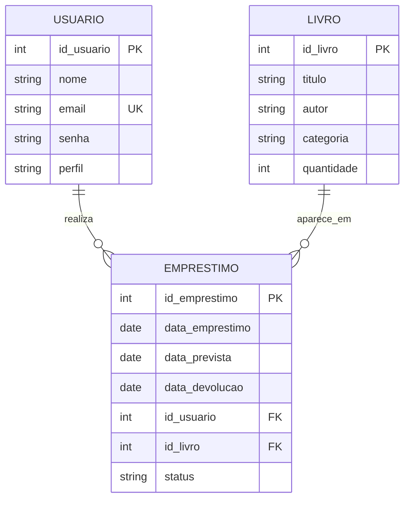

# Diagrama Entidade-Relacionamento (DER)

## Cardinalidades
- Um usuário pode realizar zero ou vários empréstimos.
- Cada empréstimo pertence a exatamente um usuário.
- Um livro pode aparecer em zero ou vários empréstimos ao longo do tempo.
- Cada empréstimo refere-se a exatamente um livro.

## Observação
`quantidade` representa a quantidade atualmente disponível. O histórico de empréstimos permanece na tabela `Emprestimo`; a devolução altera o status e registra a data efetiva.
